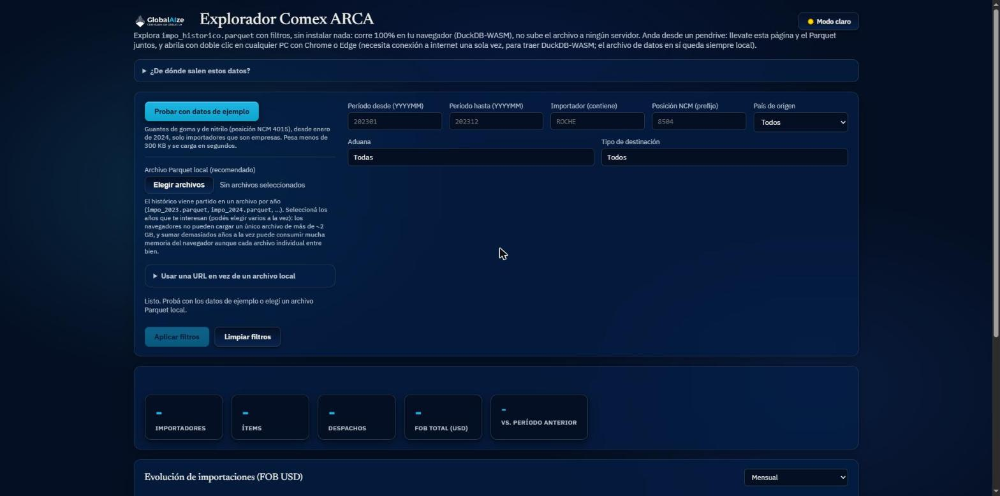
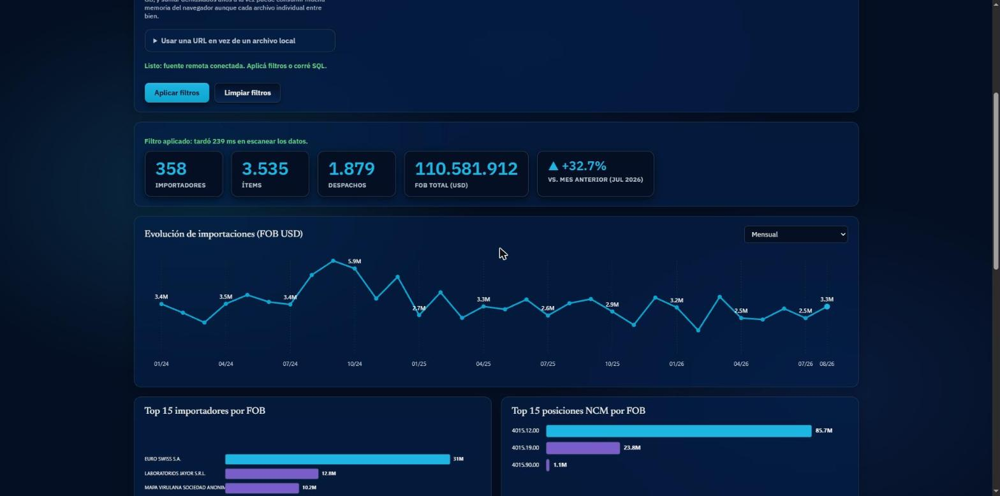
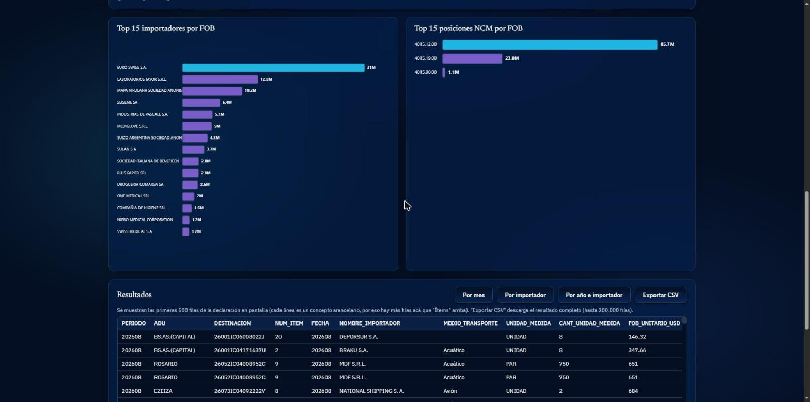
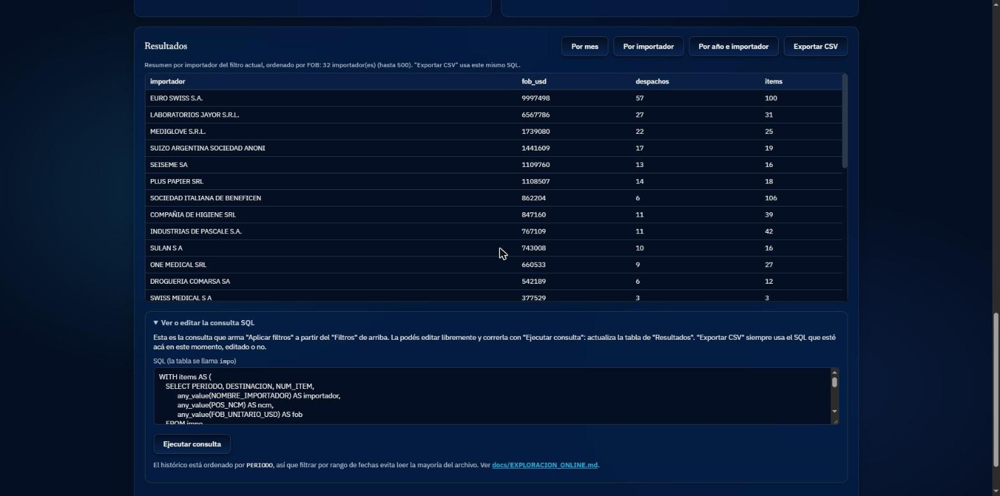

# Argentine Import Data Toolkit (ARCA)

<p>
  <a href="README.md"></a>
  <a href="README.es.md"></a>
</p>

Python tools to download, convert, query and filter the public Argentine international trade data published by ARCA.

## In short

👉 **Try it:** [mauroemartinez.github.io/analisis_datos_comex_arca/?demo=1](https://mauroemartinez.github.io/analisis_datos_comex_arca/?demo=1). It is a free GitHub page, with no server, and a small sample already loaded: rubber and nitrile gloves from January 2024 onward (under 300 KB).

With this repository you can:

1. **Download ARCA's official import data, for free**, for the range of months you choose.
2. **Turn it into compressed Parquet and merge it into a single history**, as small as possible (2018 to today, about 2 GB), queried in seconds with DuckDB or Polars.
3. **Explore it on the same page as the link above, but with your data and on your computer:** open the files you downloaded and filter by importer, NCM code, country, customs office and dates, with charts and CSV export. Nothing is uploaded anywhere.
4. **Query it with Python or SQL** and export it to Excel.

Step by step, with screenshots: [docs/TUTORIAL.en.md](docs/TUTORIAL.en.md).

Official source: ARCA's Información Agregada de Comercio Exterior (aggregated international trade data, in Spanish).

https://arca.gob.ar/operadoresComercioExterior/informacionAgregada/informacion-agregada.asp

This repository is ready to be published: it does not include monthly databases, generated outputs or real commercial lists of NCM tariff codes. The notebooks in `notebooks/` are versioned (on purpose): they are usage tutorials, reviewed and without outputs, not explorations with proprietary data.

## Stack

Python with DuckDB, Polars, pandas and PyArrow over Parquet (zstd); Jupyter notebooks with Matplotlib; the web explorer is a single static page with DuckDB-WASM and hand-drawn SVG charts, published on GitHub Pages by a GitHub Actions workflow (`.github/workflows/pages.yml`).

## What it is for

- Downloading and keeping up to date **a single** `Data/impo_historico.parquet` with all of ARCA's monthly imports (`--actualizar`, see below).
- Querying that history by importer, NCM code, general summary or free-form SQL.
- Generating a final monthly table with one row per item.
- Filtering NCM codes from an editable local list.
- Exploring it through tutorials (`notebooks/`) or a backend-free web explorer (`explorer/`), which you can [try online with sample data](https://mauroemartinez.github.io/analisis_datos_comex_arca/?demo=1). A [step-by-step tutorial](docs/TUTORIAL.en.md) shows how.

## Structure

```text
.
|-- assets/                           (screenshots used in this README)
|-- Data/
|   |-- descargar_historico_impo.py   (downloads + consolidates the single history file)
|   |-- consultar_impo.py             (quick queries by importer/NCM/SQL)
|   |-- consultar_impo_polars.py      (same summary, polars reference)
|   |-- tabla_final.py                (one-row-per-item table, one period)
|   |-- _fuente_impo.py               (resolves history vs. standalone monthly file)
|   `-- impo_historico.parquet and other local data, not versioned
|-- codigos/
|   `-- codigos_arca.py               (ARCA/AFIP code dictionaries)
|-- notebooks/
|   |-- 01_introduccion.ipynb         (basic: loading, dates, filters)
|   |-- 02_analisis_intermedio.ipynb  (time series, countries, NCM)
|   `-- 03_avanzado.ipynb             (performance, bounded memory, outliers)
|-- explorer/
|   |-- index.html                    (dashboard with filters and charts, DuckDB-WASM, no backend)
|   |-- dividir_para_navegador.py     (splits impo_historico.parquet into one .parquet per year)
|   `-- data/                         (output of dividir_para_navegador.py, not versioned)
|-- docs/
|   `-- EXPLORACION_ONLINE.md         (online/self-hosted exploration architecture, in Spanish)
|-- .claude/skills/actualizar-historico-arca/
|   `-- SKILL.md                      (runbook for updating the history file)
|-- exports/
|   `-- local working folder, not versioned (see below)
|-- filtrar_posiciones.py
|-- posiciones_interes.ejemplo.txt
|-- requirements.txt
|-- README.md                         (this file, in English)
`-- README.es.md                      (in Spanish)
```

Data and outputs are ignored by Git: `.csv`, `.xlsx`, `.parquet`, `.lst`, `.zip`, local databases and generated exports. `.claude/` is ignored except for the skill above; `*.ipynb` is ignored except for what is in `notebooks/`.

## Installation

```powershell
python -m venv .venv
.venv\Scripts\activate
pip install -r requirements.txt
```

## Downloading and converting imports

The end product of this pipeline is **a single file**: `Data/impo_historico.parquet`, with all months already merged. Everything else (ZIP, LST, monthly Parquet) is an intermediate working file, and it is deleted automatically as soon as it has been added to the history.

### One command for everything: `--actualizar`

Whether it is the first time (`impo_historico.parquet` does not exist yet) or
you already have a history and want to bring in the new months published since
the last run, the command is always the same:

```powershell
python Data\descargar_historico_impo.py --actualizar
```

- **If `impo_historico.parquet` does not exist**: it does a full load of the
  whole range ARCA has published (it can take hours and use a lot of temporary
  disk space for the final `ORDER BY`, although it frees that space on its own
  when it finishes; see "Running on a machine with 4 GB of RAM" below for what
  that means on a small machine).
- **If it already exists**: it checks the last loaded period, downloads and
  converts only what is new, and appends it **without re-sorting the hundreds
  of millions of existing rows** (see "Why DuckDB and why Parquet" below for
  the details of how). This is the intended way to run it every so often, by
  hand or by asking a Claude Code agent to do it (see the
  `actualizar-historico-arca` skill in `.claude/skills/`).
- If ARCA has not published anything new yet, it finishes right away without
  touching the file. Running it more often than needed does not break anything.

Other flags, for specific cases (most of the time `--actualizar` alone is enough):

- `--desde`/`--hasta YYYYMM`, `--mes YYYYMM` (repeatable): to limit the run to a range or to specific months instead of everything published.
- `--sin-descarga --force`: downloads nothing, only rebuilds the history from the `impo_YYYYMM.parquet` files already in `Data/` (re-sorts everything; meant for repairing the history, not for routine updates).
- `--keep-mensuales`: keeps each month's `impo_YYYYMM.parquet` after merging them (by default they are deleted, to avoid doubling the disk space used).
- `--solo-listar`: lists the periods ARCA has published and exits, without downloading anything.

Not every month has the item/importer-level detailed file this pipeline uses: **February to July and September 2018** are only published in an "aggregated" version (no importer name and no item detail, only totals by NCM code and country, with completely different columns). The script detects them on its own and skips them with a warning, without breaking; they remain a known gap in the history.

### The single history file

`Data/impo_historico.parquet` has one row per (declaration, item, tariff concept), the same as the monthly Parquet files, plus a `PERIODO` column (`YYYYMM`, text) that identifies the source month:

| Column | Type | Notes |
|---|---|---|
| `PERIODO` | text `YYYYMM` | Only in the consolidated history, not in standalone monthly Parquet files. |
| `ADU` | text | Customs office code (see `codigos/codigos_arca.py:ADUANAS`). |
| `DESTINACION` | text | Declaration/customs entry number. |
| `NUM_ITEM` | integer | Item within the declaration. |
| `FECHA` | text `YYYYMM` | Same as `PERIODO`, exactly as it comes in the `.lst`. |
| `NOMBRE_IMPORTADOR` | text | Company name. |
| `MEDIO_TRANSPORTE` | text | Code (see `codigos_arca.py:MEDIOS_TRANSPORTE`). |
| `UNIDAD_MEDIDA` | text | Code (see `codigos_arca.py:UNIDADES`). |
| `CANT_UNIDAD_MEDIDA` | double | Quantity in that unit. |
| `FOB_UNITARIO_USD` | double | Item FOB; repeated on every tax line of the same item. |
| `FOB_TOTAL_USD` | double | Total FOB of the declaration; repeated on all of its items. |
| `DIVISA` | text | Currency of the transaction. |
| `PAIS_ORIGEN` / `PAIS_PROCEDENCIA` | text | Country code (see `codigos_arca.py:PAISES`). |
| `POS_NCM` | text | Tariff code. |
| `ARANCEL_CONCEPTO` | text | Type of tax or duty on this line. |
| `ARANCEL_MONTO` | double | Amount of that tax or duty. |

`FECHA`/`PERIODO` are `YYYYMM` text, not an actual date. To convert them to `DATE` (so you can filter by range, group by year, etc.):

```sql
-- DuckDB / SQL: first day of the month
strptime(PERIODO || '01', '%Y%m%d')::DATE

-- Filter a date range
SELECT * FROM read_parquet('Data/impo_historico.parquet')
WHERE PERIODO BETWEEN '202301' AND '202312';   -- all of 2023, YYYYMM text comparison

-- Group by year (the first 4 characters of PERIODO)
SELECT substr(PERIODO, 1, 4) AS anio, sum(FOB_TOTAL_USD) FOB
FROM read_parquet('Data/impo_historico.parquet')
GROUP BY 1 ORDER BY 1;
```

```python
# pandas
import pandas as pd
df = pd.read_parquet("Data/impo_historico.parquet", columns=["PERIODO", "POS_NCM", "FOB_TOTAL_USD"])
df["fecha"] = pd.to_datetime(df["PERIODO"], format="%Y%m")
```

```python
# polars (lazy: does not load everything into RAM, only the columns it uses)
import polars as pl
q = (
    pl.scan_parquet("Data/impo_historico.parquet")
    .with_columns(pl.col("PERIODO").str.strptime(pl.Date, "%Y%m").alias("fecha"))
    .filter(pl.col("fecha").is_between(pl.date(2023, 1, 1), pl.date(2023, 12, 31)))
)
```

See `notebooks/` (in Spanish) for complete tutorials, from basic to advanced, with these and other examples.

### Why DuckDB and why Parquet

Two different tools, for two different jobs:

- **DuckDB** is the *compute* engine: it parses the `.lst` (text separated by `'`, with type sniffing that tolerates broken columns, literal quotes and report footers, see below), runs the `ORDER BY` of the consolidation, and answers ad hoc SQL queries (`consultar_impo.py`) without needing a database server or loading everything into RAM. It is the piece that makes it possible to process files of several GB on a machine with 4 GB of RAM (see "Running on a machine with 4 GB of RAM" below).
- **Parquet** is the *storage* format: columnar and compressed (zstd), it lets you read only the columns you need (column pruning) and skip entire row groups by value range (predicate pushdown), instead of reading the whole file for every query. It is also the format that DuckDB, pandas, polars and practically any modern analysis tool read without friction, so it works as a stable interface between this pipeline and whatever anyone wants to do with the data afterwards.

One detail worth pointing out: the consolidated history (`agregar_al_historico`/`combinar_historico`) avoids re-sorting the hundreds of millions of existing rows on every update. Since new months always come after everything already in the history, it is enough to sort each new month on its own (small, it fits comfortably in memory) and append it after the existing history: `PERIODO` is already increasing across files, so the result stays correctly sorted without a full `ORDER BY` over the whole dataset. That is what makes it viable to run `--actualizar` often, instead of re-sorting everything every time (which is precisely the step that uses the most RAM and temporary disk, see the 4 GB of RAM section).

### How much space Parquet saves compared with the raw `.lst`

The pipeline deletes each month's `.lst` as soon as it converts it (they are uncompressed plain text, several GB each), so they are not all kept around to measure the exact total. This is an estimate based on a sample of 7 months for which the real size of the `.lst` inside the ZIP could be measured (without decompressing it, by reading the ZIP metadata) against the size of the resulting monthly Parquet:

| Period | Uncompressed `.lst` | Monthly Parquet | Ratio |
|---|---:|---:|---:|
| 2018-10 | 3.75 GiB | 55.6 MiB | 69x |
| 2018-11 | 3.18 GiB | 46.7 MiB | 68x |
| 2018-12 | 2.73 GiB | 40.6 MiB | 67x |
| 2021-05 | 4.70 GiB | 95.2 MiB | 51x |
| 2022-11 | 5.30 GiB | 20.8 MiB | 261x |
| 2023-08 | 6.84 GiB | 31.8 MiB | 220x |
| 2025-10 | 6.46 GiB | 45.3 MiB | 146x |

The ratio varies a lot from month to month (51x to 261x) depending on how repetitive that month's values are (more distinct importers/NCM codes compress worse). Taking the size-weighted ratio of this sample (≈100x) and applying it to the 88 months with transaction-level detail that were loaded at the time of measuring (6.36 GiB in monthly Parquet, before merging them):

- **Estimated raw `.lst` (88 months)**: between ~320 GiB (most compressible end) and ~1.66 TiB (least compressible end), with **~640 GiB** as the central estimate.
- **Actual `impo_historico.parquet` (those same 88 months)**: **2.01 GiB** (616 million rows, 2018-01 to 2025-11).
- **Reduction**: between ~160x and ~825x depending on the end, **~320x** in the central case.

The consolidated history also weighs considerably less than the simple sum of its monthly Parquet files (2.01 GiB versus 6.36 GiB for those 88 months, ~3x less): with everything sorted by `POS_NCM`/`DESTINACION`/item in a single file, zstd finds many more consecutive repeated values than in 88 small files, each sorted separately. This is not just tidiness: it is the main reason why "a single history file" is smaller than "N files with the same data".

(This does not count the 7 months of 2018 that only have an aggregated report: they are a different, much smaller format, and would not be comparable.)

**Current status** (after running `--actualizar` for the first time with this version): `impo_historico.parquet` has **683,858,821 rows, 97 months, 2018-01 to 2026-08**, in **2.17 GiB**. Scaling the estimate above in proportion to the growth in rows (683,858,821 / 616,041,305 ≈ 1.11x), the equivalent raw `.lst` would be around **~710 GiB** (range ~355 GiB to ~1.8 TiB), that is, practically the same order of magnitude of reduction (~325x in the central case). This figure will be re-run, not recalculated by hand, on each future update: there is no need to keep it in sync by hand, it is just a snapshot of this moment.

### Running on a machine with 4 GB of RAM

This downloader was tested by downloading the full history (more than 100 months, some with `.lst` files of several GB of plain text) on a laptop with **4 GB of RAM in total**, often with less than 1 GB free because Chrome, VS Code and other apps were open. That brought to light several problems that a single test month does not show:

- **Items with no associated tax**: the amount field is filled with spaces instead of being empty, and DuckDB could not type the column directly from the CSV. Everything is read as `VARCHAR` and cast with `TRY_CAST(NULLIF(TRIM(...), ''), tipo)`.
- **Report footer at the end of each `.lst`**: blank lines plus a `"N rows selected."` after the last real row, which broke the expected column count. It is filtered out by checking that `FECHA` has a period format (`^[0-9]{6}$`).
- **Literal quotes in some company names**: one company has a `"` as part of its name, and DuckDB took it as a quote delimiter instead of plain text. The file is read with `quotechar=""` so that no quote character is interpreted as one.
- **No RAM headroom for months of several GB**: with a low `PRAGMA memory_limit` (set by hand according to the free RAM at the time, between 400 MB and 1 GB) and `threads=1`, DuckDB spills to disk instead of trying to use all the available RAM. And most importantly: **each month is converted in a separate Python process** (`--convertir-uno PERIODO`, via `subprocess.run`), so the operating system frees all that memory when that particular month finishes, instead of relying on the runtime to free it between iterations of a single long-running process.

If you run this on an even smaller machine, lower `memory_limit` further in `Data/descargar_historico_impo.py` (look for `PRAGMA memory_limit`).

## Notebooks

`notebooks/` has three tutorials (in Spanish), from basic to advanced, meant to be read in order:

1. **`01_introduccion.ipynb`**: loading the history, available columns, `YYYYMM` → `DATE` dates, basic filters and aggregates.
2. **`02_analisis_intermedio.ipynb`**: time series, year-over-year change, decoding countries/customs offices with `codigos_arca.py`, rankings by NCM code and importer.
3. **`03_avanzado.ipynb`**: why the order of the file makes filtering by date cheap, lazy `polars`, processing in chunks with little RAM, price outlier detection, exporting large subsets.

They are versioned without outputs (run them and save them clean if you edit them). They require `jupyterlab`, `matplotlib` and `polars` from `requirements.txt`:

```powershell
jupyter lab notebooks
```

## Exploring the dataset online or self-hosted (or from a USB drive)

> **Try it online, nothing to install:** [https://mauroemartinez.github.io/analisis_datos_comex_arca/?demo=1](https://mauroemartinez.github.io/analisis_datos_comex_arca/?demo=1) opens the explorer with a sample already loaded: rubber and nitrile gloves (NCM 4015), January 2024 onward, only importers that are companies (individuals are left out), under 300 KB. The same page also opens your own local Parquet files, which never leave your computer.
>
> **Step-by-step tutorial, with screenshots:** [docs/TUTORIAL.en.md](docs/TUTORIAL.en.md): the online explorer, the explorer with the full history, and queries with Python and SQL (including why you must collapse to one row per item before adding up FOB).
>
> **How it is published:** a GitHub Action (`.github/workflows/pages.yml`) copies `explorer/index.html` and the sample in `explorer/demo/` to GitHub Pages on every push that touches them. The sample is rebuilt with `python explorer/armar_demo.py Data/impo_historico.parquet explorer/demo/guantes-4015.parquet`. The full history is not published (see below).

`explorer/index.html` is a static page, with no backend, that runs **DuckDB directly in the browser** (via DuckDB-WASM) against `impo_historico.parquet`, with filters (importer, NCM code, country, customs office, customs regime type, date range), charts (monthly/quarterly/yearly/year-over-year evolution, top 15 importers, top 15 NCM codes) and an indicator of change against the previous period. No SQL box is required: the filters build the queries on their own (although there is still an "Avanzado" (Advanced) section with free-form SQL for anyone who wants it).

Filters, with several years loaded at once and multiple selection for customs office / customs regime type:

<p align="center"></p>

Metric cards (importers, items, customs entries, FOB, change) and the evolution chart:

<p align="center"></p>

Top 15 importers and top 15 NCM codes by FOB:

<p align="center"></p>

Results table, with the SQL query built by the filters (editable) and "Exportar CSV" (Export CSV):

<p align="center"></p>

Two ways to use it, without writing any code:

- **Local, with no internet needed for the data** (designed to be carried on a USB drive): you pick the Parquet file with the page's file selector; it is never uploaded anywhere, and all the computing happens in your browser. It only needs internet once, to fetch DuckDB-WASM.
- **With a remote URL**: if the Parquet file is published on an object storage service that supports Range requests, the page requests over HTTP only the row groups each query needs (it takes advantage of the same sort by `PERIODO` that already makes date filters cheap in native DuckDB).

### Splitting the history into one file per year, for local use

`impo_historico.parquet` already weighs more than 2 GiB, which is the limit Chrome (and the other Chromium-based browsers) has for loading a file into memory in one go. To keep using the local explorer with the full history, you first have to split it:

```powershell
python explorer\dividir_para_navegador.py
```

This generates `explorer/data/impo_YYYY.parquet`, one file per year (measured on the real history: 2018 weighs ~104 MiB, and the heaviest year so far, 2024, ~314 MiB, all well below the browser limit). It is best to run it after each `--actualizar`, so the current year stays up to date.

In the file selector of `explorer/index.html` you can pick **several years at once**: the explorer combines them with DuckDB's `read_parquet([...])` and treats them as a single table, without the user having to do anything special. Practical recommendation: do not load more than ~2 GiB in total at once in the browser (that is, not all 9 years together): it is not only the limit for an individual file, but the total memory the browser has to hold for that tab. For analyses that need to combine the entire history at once, use the notebooks or `consultar_impo.py`/`tabla_final.py` locally: there the limit is the machine's RAM, not a fixed browser ceiling, and they are already designed to run with little RAM (see "Running on a machine with 4 GB of RAM" above).

Why the split or full file is not published in this GitHub repository: even split by year, each file weighs between ~100 and ~330 MiB, above the 100 MB per-file limit that Git applies without extensions (Git LFS or GitHub Releases allow it, but they add a quota or cost and one more piece to keep in sync on every monthly update, with no real need). That is why this repository publishes the *code* that generates the data, not the data itself: anyone can rebuild exactly the same `impo_historico.parquet` by running `python Data\descargar_historico_impo.py --actualizar` (by hand, or by asking a Claude Code agent to do it with the `actualizar-historico-arca` skill in `.claude/skills/`), and then split it locally with `dividir_para_navegador.py` if they are going to use it in the web explorer.

See `docs/EXPLORACION_ONLINE.md` (in Spanish) for the full decision (why not a database, how it works inside, the layered architecture, and the concrete steps to actually publish it with a URL).

## Quick queries

General summary (the whole history if `impo_historico.parquet` exists, or the latest standalone month if not):

```powershell
python Data\consultar_impo.py --resumen
```

Search by importer:

```powershell
python Data\consultar_impo.py "IMPORTADOR"
```

Search by importer and NCM prefix:

```powershell
python Data\consultar_impo.py "IMPORTADOR" --ncm 8504
```

Run free-form SQL on the `impo` view:

```powershell
python Data\consultar_impo.py --sql "SELECT POS_NCM, count(*) filas FROM impo GROUP BY 1 ORDER BY filas DESC LIMIT 20"
```

## Final monthly table

On the consolidated history, with no period given: it takes the latest one available.

```powershell
python Data\tabla_final.py
```

A specific period from the history:

```powershell
python Data\tabla_final.py --periodo 202508
```

Local outputs:

```text
Data/impo_YYYYMM_tabla_final.parquet
Data/impo_YYYYMM_tabla_final.xlsx
```

## Filtering NCM codes

The repository includes a public example list:

```text
posiciones_interes.ejemplo.txt
```

To work with your own list, create a local copy:

```powershell
Copy-Item posiciones_interes.ejemplo.txt posiciones_interes.txt
```

Then edit `posiciones_interes.txt` and run:

```powershell
python filtrar_posiciones.py
```

Force Excel output:

```powershell
python filtrar_posiciones.py --xlsx
```

You can also pass a different codes file:

```powershell
python filtrar_posiciones.py mi_lista_ncm.txt
```

## Local working folder (`exports/`)

`exports/` is a folder meant for personal use: a place where anyone can collect their own files, try things out and save exports without the risk of pushing them to the public repository by mistake. All of its contents are ignored by Git (`/exports/` in `.gitignore`), except for the notice file inside it.

It is not required for the code to work: the scripts never read from or write to `exports/` automatically. It is simply a convention to avoid cluttering `Data/` (which is where the scripts and the pipeline's own outputs live) with personal files, drafts or test results.

## Quick validation

```powershell
python -B -m py_compile filtrar_posiciones.py Data\consultar_impo.py Data\consultar_impo_polars.py Data\tabla_final.py Data\descargar_historico_impo.py Data\_fuente_impo.py codigos\codigos_arca.py
python Data\descargar_historico_impo.py --actualizar
```

`--sin-descarga --force` (rebuilds from whatever `impo_YYYYMM.parquet` files are in `Data/`) is only useful as a check if you ran something with `--keep-mensuales` before: by default no standalone monthly files are left once they are merged into the history, so there is nothing to rebuild from.

For the notebooks, run them from start to finish before committing (for example with `jupyter nbconvert --to notebook --execute --inplace notebooks/*.ipynb`) and strip their outputs afterwards, following the repo's "clean notebooks" convention.

## A note on data

ARCA's data is public, but commercial subsets, internal analyses and generated files must not be versioned. The notebooks in `notebooks/` are versioned because they are usage tutorials rewritten for publication, with no outputs or proprietary data; any exploratory notebook with results or internal analyses goes in `exports/` (gitignored), not in `notebooks/`. This repo is meant to publish the code and keep proprietary data local.
