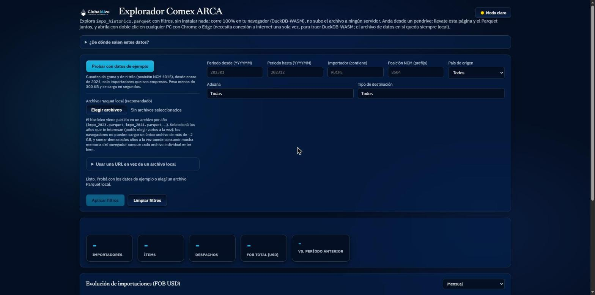
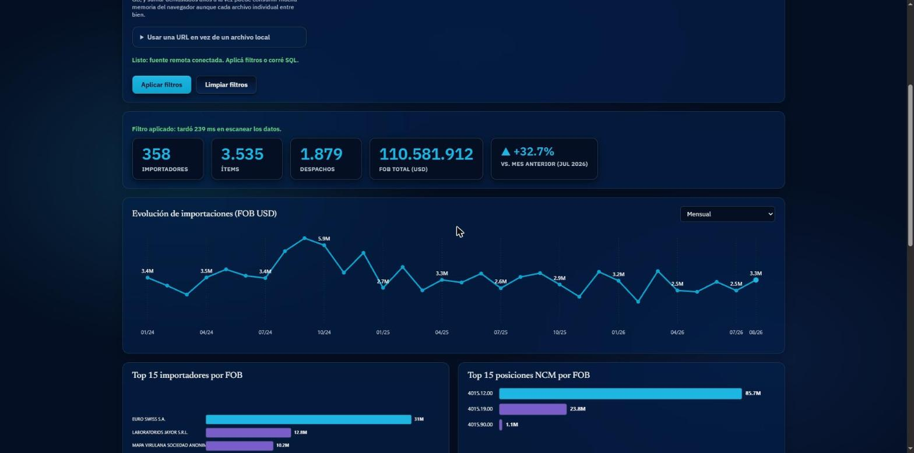
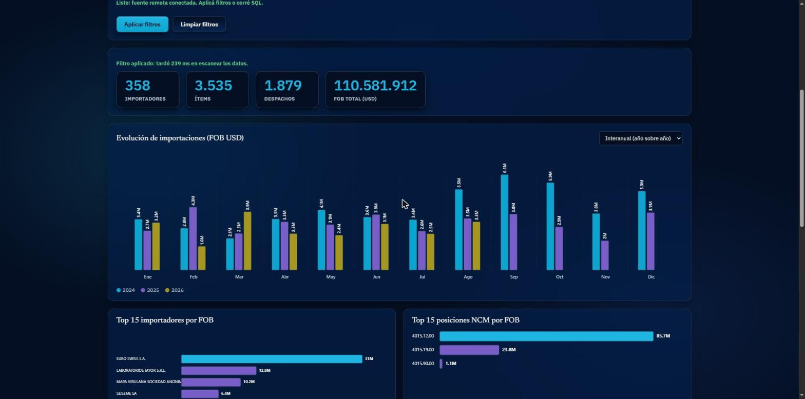
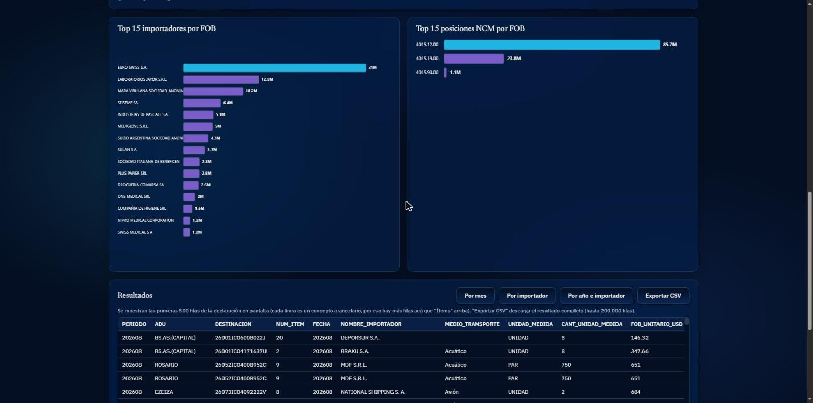
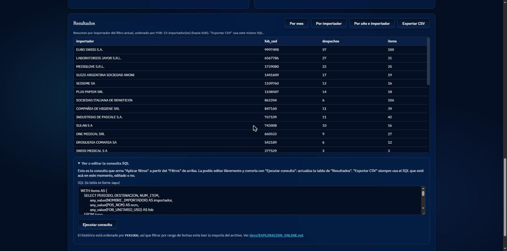
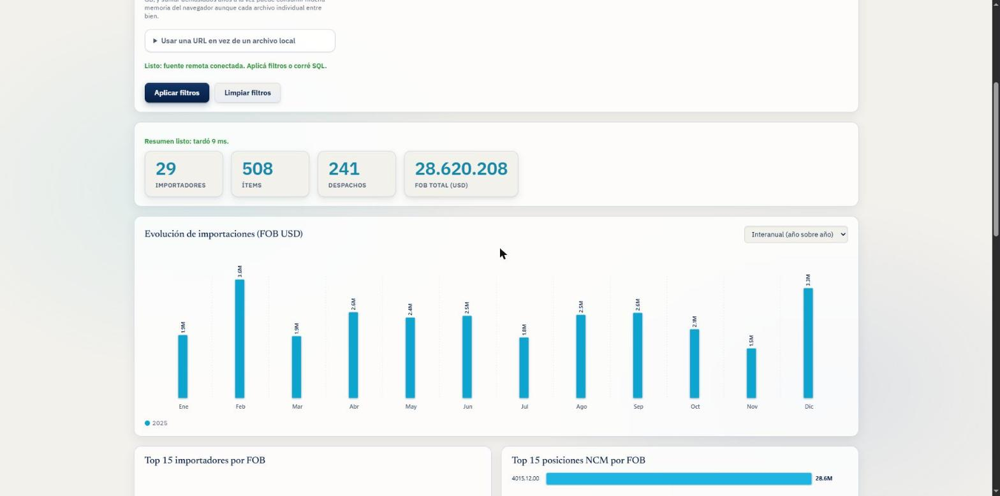

# Tutorial: how to query ARCA's import data
<p>
  <a href="TUTORIAL.en.md"></a>
  <a href="TUTORIAL.md"></a>
</p>

Three ways to query the data, from the simplest to the most powerful:

1. [**The online explorer**](#1-the-online-explorer-nothing-to-install): one link, nothing to install. To look and filter.
2. [**The explorer with your own data**](#2-the-explorer-with-the-full-history): the same page, with the whole history you downloaded.
3. [**Python and SQL**](#3-queries-with-python-and-sql): to export to Excel, join with other data or automate.

Before you start, one warning that applies to all three: [how the data is laid out](#before-you-add-anything-up).

The explorer itself is in Spanish; the screenshots below show what each part does.

---

## 1. The online explorer, nothing to install

**Open** [mauroemartinez.github.io/analisis_datos_comex_arca/?demo=1](https://mauroemartinez.github.io/analisis_datos_comex_arca/?demo=1). With `?demo=1` the sample loads by itself; without it, press **"Probar con datos de ejemplo"** (try with sample data).

<p align="center"></p>

The sample is **rubber and nitrile gloves (NCM 4015) from January 2024 onward**, only importers that are companies: individuals are left out. Everything runs in your browser: there is no server, and nothing you do leaves your computer.

**Step by step:**

1. **Press "Aplicar filtros"** (apply filters) without touching anything: you see the whole sample.
2. **Look at the cards on top:** importers, items, customs entries, total FOB and the change against the previous period.

<p align="center"></p>

3. **Switch the chart view** with the selector on the right:
   - **Monthly:** a date and value every 3 months (January, April, July and October) and on the latest month. With many months, a scroll appears, starting on the right, at the most recent data.
   - **Quarterly** and **Yearly:** the same chart, grouped.
   - **Year over year:** each month with one bar per year, to compare January against January. Every bar carries its value on top.

<p align="center"></p>

4. **Hover** over a point or a bar: the tooltip shows FOB, importers, entries and items, with the change against the previous one.
5. **Scroll down to the rankings:** the 15 importers and the 15 NCM codes with the most FOB. Below them, the detail table.

<p align="center"></p>

6. **Filter.** For example, to see who imported nitrile gloves (NCM 4015.12) in 2025:
   - Period from `202501` to `202512`.
   - NCM code `4015.12`.
   - **Aplicar filtros**.
7. **Summarize** with the table buttons: by month (**Por mes**), by importer (**Por importador**) or by year and importer (**Por año e importador**).
8. **See or edit the SQL** under "Ver o editar la consulta SQL": it is the query the filters build, and you can change it and run it again.
9. **Export to CSV** the full result, up to 200,000 rows.

<p align="center"></p>

**Light mode:** the button on the top right switches between dark and light.

<p align="center"></p>

---

## 2. The explorer with the full history

The sample is small on purpose. To query **every product since 2018**:

1. **Download the history** with the repository's script (the first time takes a while; after that, it only downloads the new months):
   ```powershell
   python Data\descargar_historico_impo.py --actualizar
   ```
2. **Split it by year**, because browsers cannot load files above ~2 GB:
   ```powershell
   python explorer\dividir_para_navegador.py
   ```
3. **Open `explorer/index.html`** (double click, or from the online page) and, under **"Elegir archivos"** (choose files), pick the years you need, several at once. The files are read in your browser and are not uploaded anywhere.
4. **Filter and summarize** as in part 1. Tip: do not load more than ~2 GB together (about 6 or 7 years).

---

## 3. Queries with Python and SQL

For what does not fit in the browser, or to take the data to Excel.

**General summary:**
```powershell
python Data\consultar_impo.py --resumen
```

**Everything from one importer, to Excel** (creates `impo_<name>.xlsx`):
```powershell
python Data\consultar_impo.py "EURO SWISS"
```

**One importer and one NCM code:**
```powershell
python Data\consultar_impo.py "EURO SWISS" --ncm 4015
```

**Free-form SQL** on the `impo` table:
```powershell
python Data\consultar_impo.py --sql "SELECT POS_NCM, count(*) AS rows FROM impo GROUP BY 1 ORDER BY rows DESC LIMIT 20"
```

The notebooks in `notebooks/` (introduction, intermediate and advanced) walk through the same steps, with charts.

---

## Before you add anything up

ARCA's data has **one row per tariff concept** (duties, statistics fee, VAT...) for each item of the customs entry. The FOB value is repeated on every row of the same item. If you sum the FOB column row by row, **you multiply the amount** by the number of taxes.

So first collapse to **one row per item**, and only then add up. This is how the explorer does it:

```sql
WITH items AS (
    SELECT PERIODO, DESTINACION, NUM_ITEM,
           any_value(NOMBRE_IMPORTADOR) AS importer,
           any_value(POS_NCM)           AS ncm,
           any_value(FOB_UNITARIO_USD)  AS fob
    FROM impo
    WHERE POS_NCM LIKE '4015%' AND PERIODO BETWEEN '202501' AND '202512'
    GROUP BY PERIODO, DESTINACION, NUM_ITEM
)
SELECT importer, sum(fob) AS fob_usd, count(*) AS items
FROM items
GROUP BY importer
ORDER BY fob_usd DESC
LIMIT 20;
```

Two more things to keep in mind:
- **`FECHA` and `PERIODO` are `YYYYMM` text.** For a real date: `strptime(FECHA || '01', '%Y%m%d')::DATE`.
- **ARCA publishes the letter Ñ as "?"** (for example, "COMPA?IA"). The explorer fixes it while reading the data; in Python or SQL, search with `LIKE 'COMPA_IA%'` or replace the "?" between letters with "Ñ".

---

Made by [GlobalAIze](https://www.globalaize.com): AI agents, automation and data analysis for international trade companies.
