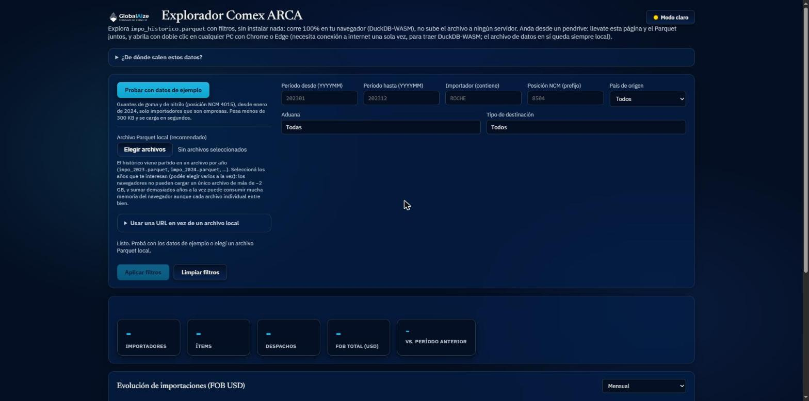
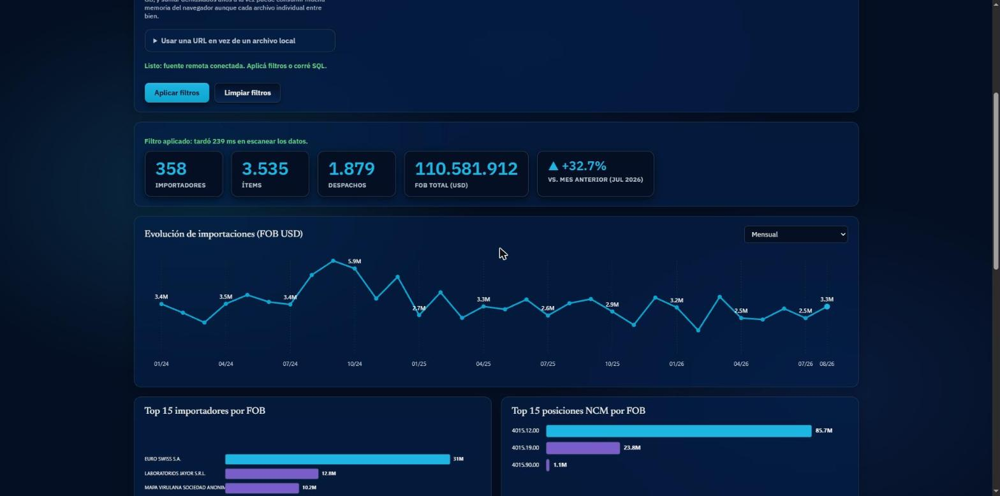
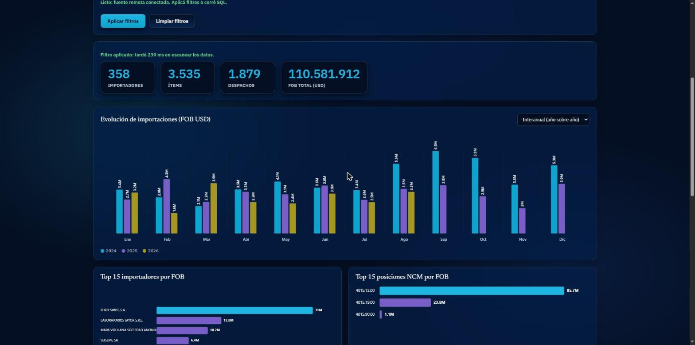
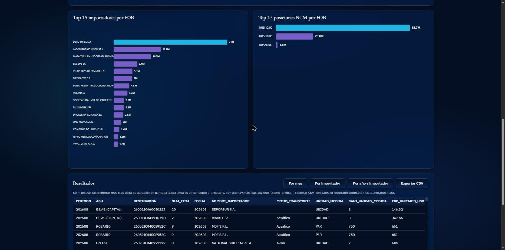
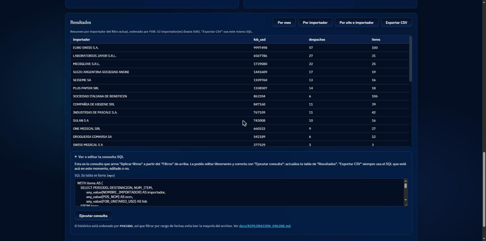
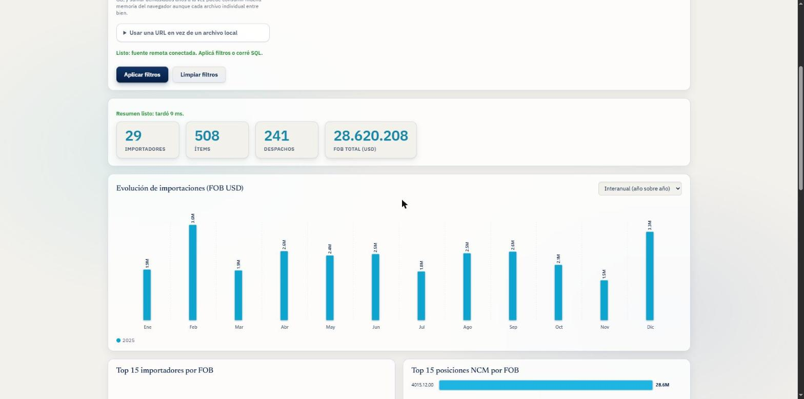

# Tutorial: cómo consultar las importaciones de ARCA
<p>
  <a href="TUTORIAL.en.md"></a>
  <a href="TUTORIAL.md"></a>
</p>

Tres formas de consultar los datos, de la más simple a la más potente:

1. [**El explorador online**](#1-el-explorador-online-sin-instalar-nada): un link, nada que instalar. Para mirar y filtrar.
2. [**El explorador con tus propios datos**](#2-el-explorador-con-el-histórico-completo): la misma página, con todo el histórico que bajaste.
3. [**Python y SQL**](#3-consultas-con-python-y-sql): para exportar a Excel, cruzar con otros datos o automatizar.

Antes de empezar, una advertencia que vale para las tres: [cómo están armados los datos](#antes-de-sumar-cualquier-cosa).

---

## 1. El explorador online, sin instalar nada

**Abrí** [mauroemartinez.github.io/analisis_datos_comex_arca/?demo=1](https://mauroemartinez.github.io/analisis_datos_comex_arca/?demo=1). Con `?demo=1` el ejemplo se carga solo; sin eso, apretá **"Probar con datos de ejemplo"**.

<p align="center"></p>

El ejemplo son **guantes de goma y de nitrilo (posición NCM 4015) desde enero de 2024**, solo importadores que son empresas: las personas físicas quedan afuera. Todo corre en tu navegador: no hay servidor y nada de lo que hagas sale de tu computadora.

**Paso a paso:**

1. **Apretá "Aplicar filtros"** sin tocar nada: ves todo el ejemplo.
2. **Mirá las tarjetas de arriba:** importadores, ítems, despachos, FOB total y la variación contra el período anterior.

<p align="center"></p>

3. **Cambiá la vista del gráfico** con el selector de la derecha:
   - **Mensual:** fecha y valor cada 3 meses (enero, abril, julio y octubre) y en el último mes. Si hay muchos meses, aparece un scroll que arranca a la derecha, en lo más reciente.
   - **Trimestral** y **Anual:** el mismo gráfico, agrupado.
   - **Interanual:** cada mes con una barra por año, para comparar enero contra enero. Cada barra lleva su valor arriba.

<p align="center"></p>

4. **Pasá el mouse** por un punto o una barra: el recuadro muestra FOB, importadores, despachos e ítems, con la variación contra el anterior.
5. **Bajá a los rankings:** los 15 importadores y las 15 posiciones NCM con más FOB. Debajo, la tabla con el detalle.

<p align="center"></p>

6. **Filtrá.** Por ejemplo, para ver quién importó guantes de nitrilo (posición 4015.12) en 2025:
   - Período desde `202501` y hasta `202512`.
   - Posición NCM `4015.12`.
   - **Aplicar filtros**.
7. **Resumí** con los botones de la tabla: **Por mes**, **Por importador** o **Por año e importador**.
8. **Mirá o editá el SQL** en "Ver o editar la consulta SQL": es la consulta que arman los filtros, y se puede cambiar y volver a correr.
9. **Exportá a CSV** el resultado completo, hasta 200.000 filas.

<p align="center"></p>

**Modo claro:** el botón de arriba a la derecha cambia entre oscuro y claro.

<p align="center"></p>

---

## 2. El explorador con el histórico completo

El ejemplo es chico a propósito. Para consultar **todos los productos desde 2018**:

1. **Bajá el histórico** con el script del repo (la primera vez tarda; después, solo baja los meses nuevos):
   ```powershell
   python Data\descargar_historico_impo.py --actualizar
   ```
2. **Partilo por año**, porque los navegadores no cargan archivos de más de ~2 GB:
   ```powershell
   python explorer\dividir_para_navegador.py
   ```
3. **Abrí `explorer/index.html`** (con doble clic, o desde la página online) y en **"Elegir archivos"** elegí los años que te interesan, varios a la vez. Los archivos se leen en tu navegador y no se suben a ningún lado.
4. **Filtrá y resumí** igual que en la parte 1. Recomendación: no cargues más de ~2 GB juntos (unos 6 o 7 años).

---

## 3. Consultas con Python y SQL

Para lo que no entra en el navegador, o para llevar los datos a Excel.

**Resumen general:**
```powershell
python Data\consultar_impo.py --resumen
```

**Todo lo de un importador, a Excel** (genera `impo_<nombre>.xlsx`):
```powershell
python Data\consultar_impo.py "EURO SWISS"
```

**Un importador y una posición NCM:**
```powershell
python Data\consultar_impo.py "EURO SWISS" --ncm 4015
```

**SQL libre** sobre la tabla `impo`:
```powershell
python Data\consultar_impo.py --sql "SELECT POS_NCM, count(*) AS filas FROM impo GROUP BY 1 ORDER BY filas DESC LIMIT 20"
```

Los notebooks de `notebooks/` (introducción, intermedio y avanzado) recorren lo mismo paso a paso, con gráficos.

---

## Antes de sumar cualquier cosa

Los datos de ARCA tienen **una fila por cada concepto de arancel** (derechos, tasa de estadística, IVA...) de cada ítem del despacho. El FOB se repite en todas las filas del mismo ítem. Si sumás la columna FOB fila por fila, **multiplicás el monto** por la cantidad de tributos.

Por eso, primero se junta **una fila por ítem** y recién después se suma. Así lo hace el explorador:

```sql
WITH items AS (
    SELECT PERIODO, DESTINACION, NUM_ITEM,
           any_value(NOMBRE_IMPORTADOR) AS importador,
           any_value(POS_NCM)           AS ncm,
           any_value(FOB_UNITARIO_USD)  AS fob
    FROM impo
    WHERE POS_NCM LIKE '4015%' AND PERIODO BETWEEN '202501' AND '202512'
    GROUP BY PERIODO, DESTINACION, NUM_ITEM
)
SELECT importador, sum(fob) AS fob_usd, count(*) AS items
FROM items
GROUP BY importador
ORDER BY fob_usd DESC
LIMIT 20;
```

Otras dos cosas a tener en cuenta:
- **`FECHA` y `PERIODO` son texto `AAAAMM`.** Para una fecha de verdad: `strptime(FECHA || '01', '%Y%m%d')::DATE`.
- **ARCA publica la Ñ como "?"** (por ejemplo, "COMPA?IA"). El explorador la corrige al leer los datos; en Python o SQL, buscá con `LIKE 'COMPA_IA%'` o reemplazá el "?" entre letras por "Ñ".

---

Hecho por [GlobalAIze](https://www.globalaize.com): agentes de IA, automatizaciones y análisis de datos para empresas de comercio exterior.
